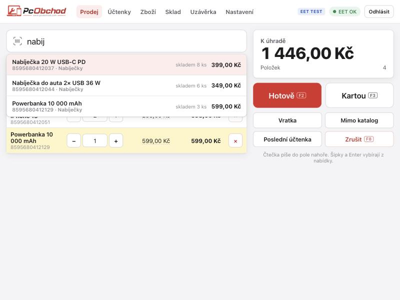

# Pokladna PcObchod

Lokální pokladna se skladem a EET 2.0 pro prodejny PcObchod (Rumburk, Varnsdorf). Server běží v prodejně, obsluha je ve webovém prohlížeči z libovolného zařízení na síti prodejny. Každá prodejna má vlastní instalaci a databázi, protože jde o dvě firmy s vlastním EIČ a certifikátem.

## Co umí (stav 26. 10. 2026)

- **Prodej:** načtení čtečkou EAN (`3*kód` = 3 kusy), hledání podle názvu bez ohledu na diakritiku, změna ceny a sleva, položka mimo katalog, vratka, platba hotově se zaokrouhlením a výpočtem vrácení, platba kartou. Klávesy F2 (hotově), F3 (kartou) a F8 (zrušit).
- **EET 2.0:** tržba se odesílá hned při prodeji (mezní doba odezvy, výchozí 3 s). Když to nejde, fronta na pozadí zkouší odeslání každých 30 s (zákonná lhůta je 48 h). Storno odešle zápornou tržbu. V hlavičce je ukazatel stavu EET.
- **Prodejky:** přehled po dnech, detail, storno, ruční opakované odeslání do EET a tisk na 80mm tiskárnu (zjednodušený daňový doklad s rekapitulací DPH).
- **Doklady vydané (po vzoru iDokladu):**
  - **faktury**: z košíku, k už zaplacené prodejce nebo nové; placená hotově nebo kartou vytvoří i prodejku s EET, převodem vydá zboží ze skladu bez EET,
  - **zálohové faktury**: po zaplacení vznikne sám daňový doklad k přijaté platbě; konečná faktura zálohu odečte,
  - **opravné daňové doklady (dobropisy)** k faktuře s důvodem opravy; vrácené zboží jde naskladnit zpět,
  - **cenové nabídky** s platností; z nabídky jedním tlačítkem faktura nebo záloha,
  - **přenesená daňová povinnost** (mobily, notebooky nad 100 tis. pro plátce): ceny bez DPH, text podle § 92a,
  - vlastní číselné řady a variabilní symboly, které se mezi řadami nepletou,
  - **upomínky** e-mailem jednotlivě i hromadně všem po splatnosti,
  - **banka**: načtení výpisu (GPC/ABO, XML camt.053, CSV z Fio, MONETA…) a spárování plateb s fakturami podle VS a částky, ruční spárování zbytku,
  - adresář kontaktů a ARES, náhled a tisk A4, PDF s QR platbou, ISDOC, odeslání e-mailem, storno a kopie.
- **Pokladní kniha:** hotovost v šuplíku z prodejek a pokladních dokladů. Vklad, výběr, odvod tržby a nákup za hotové jako příjmový a výdajový pokladní doklad s tiskem (i částka slovy). Spočítání pokladny po bankovkách a mincích, manko nebo přebytek se zapíše. Měsíční kniha s průběžným zůstatkem.
- **Export pro účetní:** jeden ZIP za měsíc: přehled v Excelu (souhrn DPH, tržby po dnech, prodejky, vydané doklady, příjemky, výdejky, pokladní doklady, stav skladu), vydané doklady v PDF a ISDOC 6.0.2 (ověřeno proti oficiálnímu schématu) a přijaté faktury dodavatelů. Stáhnout nebo poslat účetní e-mailem.
- **Servis a reklamace:**
  - zakázky na opravu i reklamace: zákazník, zařízení, IMEI / SN, příslušenství, stav při převzetí, kód odemčení, závada, předběžná cena a souhlas do částky, termín,
  - reklamace hlídá zákonnou lhůtu 30 dní (filtr „Hoří lhůta“), doklad o koupi se dohledá podle IMEI,
  - stavy od přijetí přes diagnostiku, čekání na díl nebo zákazníka a předání dodavateli (s číslem RMA) až po vyzvednutí, historie s poznámkami,
  - práce a díly ze skladu, záloha přes pokladnu (s EET), výdej s prodejkou, na fakturu nebo zdarma (díly výdejkou),
  - tisk: převzetí do servisu, potvrzení o uplatnění reklamace, potvrzení o vyřízení (s dobou vyřízení), štítek na zařízení s čárovým kódem; e-mail zákazníkovi.
- **Sériová čísla / IMEI a záruka:** u zboží s evidencí se při prodeji načte číslo každého kusu; je na účtence, v záručním listu a dohledá se při reklamaci.
- **Štítky a cenovky:** EAN-13, EAN-8 a Code 128 kreslené přímo v prohlížeči; štítky 50 × 30, 40 × 25 mm na tiskárnu štítků nebo arch A4 24 ks. Ze zboží, z příjemky (počet podle přijatého množství) i ze servisu. Interní EAN 29… pro zboží bez kódu.
- **Návrh objednávky:** zboží na minimálním stavu podle dodavatelů z posledního příjmu, s prodejem za 30 a 90 dní; tisk, CSV a zkopírování seznamu.
- **Uzávěrka e-mailem:** souhrn dne v těle e-mailu a měsíční přehled v Excelu (dny, prodejky, prodané zboží). Odesílá se tlačítkem nebo automaticky v nastavený čas přes SMTP účet prodejny.
- **Zboží:** katalog s více EAN na položku, kategorie, prodejní a nákupní cena, marže, minimální stav a historie pohybů.
- **Sklad:**
  - stav a hodnota skladu, inventura,
  - příjem zboží čtečkou nebo z faktury (příjemka); u každé položky jde rovnou změnit prodejní cenu a pokladna ukáže marži,
  - výdej zboží jinak než prodejem (výdejka): odpis, vlastní spotřeba/servis, vrácení dodavateli, manko, jiný výdej; hodnota v nákupních cenách, upozorní, když zboží na skladě nestačí,
  - doklady: příjemky a výdejky s filtrem období a hledáním, detail s tiskem A4 (Předal/Převzal), storno, které vrátí stav skladu,
  - pohyby: každý pohyb zboží (příjem, prodej, výdej, storno, korekce) se stavem po pohybu.
- **Naskladnění z faktury:** nahraje se faktura dodavatele a pokladna z ní vytáhne položky a spáruje je s katalogem.
  - Formáty: ISDOC, ISDOCX nebo PDF. Z PDF se nejdřív zkusí vložený ISDOC, pak čtení přes Claude (když je v nastavení API klíč) a nakonec odhad z textu PDF.
  - Odhad z textu čte PDF v rozvržení sloupců: číslo dokladu, IČO a DIČ dodavatele (ne vlastní), název dodavatele, řádky „množství × cena = celkem“ i dvouřádkové položky. Na 65 skutečných fakturách různých dodavatelů našel položky u 45, naskenovaná PDF přečte jen Claude.
  - Párování: podle EAN, podle zapamatovaného kódu dodavatele, podle interního kódu a nakonec podle podobného názvu (jen jako návrh ke kontrole).
  - Pokladna si pamatuje i počet kusů v balení. Neznámé položky jde rovnou založit, cena se navrhne podle výchozí marže. Doprava a poplatky se přeskakují.
  - Upozorní na fakturu, která už byla naskladněna. Soubor faktury se uloží k příjemce.
- **Uzávěrka:** tržba hotově a kartou, storna, DPH, hotovost v pokladně (ráno, tržby, vklady, výběry, má být), přehled po prodavačích a EET, tisk.
- **Uživatelé:** přihlášení PINem, role prodavač a správce.
- **Záloha:** každý den šifrovaná záloha (AES-256) databáze, faktur a certifikátů. Odchází mimo prodejnu přes rclone (Google Disk a další) nebo na USB disk či NAS. Správce vidí upozornění, když 36 h neodešla, obnova je jedním příkazem.
- **Certifikát EET:** nahrává se přes rozhraní (soubor .p12 a heslo), EIČ se vyplní samo.
- **Čtečka na české klávesnici:** kód napsaný jako „áříř…“ se sám převede na číslice.

- **Import z Trellu:** Nastavení → Import z Trellu (nebo `python -m pokladna.import_trell SOUBOR.xml --provest`). Načte XML export skladových karet z Trellu (export pro e-shop): název, kategorii, prodejní cenu, EAN nebo interní kód a stav skladu, nejdřív jako náhled.
  - Trell píše v hlavičce iso-8859-2, data jsou ve windows-1250 – import to opraví, stejně jako neošetřené „&“. Předponu „X“ u kódů odstraní, UPC (12 číslic) uloží i s nulou na začátku, kategorie lišící se velikostí písmen sloučí.
  - DPH se nastaví 21 % a nákupní cena se doplní při prvním příjmu (Trell je neexportuje). Stav se zapíše jako inventura „import Trell“, záporné stavy jde zapsat jako 0.
  - U telefonů, tabletů, notebooků a počítačů (podle kategorie nebo začátku názvu „MT“, „NTB“…, kromě příslušenství) zapne načítání IMEI / SN.
  - Opakovaný import (finálně k 31. 12.) existující zboží najde podle EAN nebo kódu, aktualizuje a stav dorovná, nic nezdvojí. Export z Varnsdorfu (13 639 karet) se načte za 1 s.

**Instalace do prodejny** (mini PC s Debianem nebo Raspberry Pi), záloha, obnova a nastavení pokladního PC: [instalace/README.md](instalace/README.md).



## Demo v prohlížeči

**https://bftech22.github.io/Pokladna_PcObchod/** – vyzkoušení bez instalace, i na mobilu. PIN šéf `1234`, prodavač `1111`. Data zůstávají jen v prohlížeči toho, kdo demo zkouší, a EET se jen předstírá. Vzorová faktura ISDOC ke zkoušení naskladnění se stáhne z lišty dema.

Demo je složka `docs/` (GitHub Pages: Settings → Pages → Deploy from branch `main`, složka `/docs`). Po změně rozhraní se znovu sestaví příkazem `.venv/bin/python -I _zdroje/skripty/postav_demo.py`. Napodobenina serveru je v `demo/demo.js`.

**Skutečný sklad Varnsdorf v demu (chráněno heslem).** V liště dema je odkaz „🔒 skutečný sklad Varnsdorf“. Katalog a stav skladu z Trellu jsou v repozitáři jen zašifrované (`demo/sklad-varnsdorf.enc`, PBKDF2-SHA256 600 000× + AES-256-GCM). Po zadání hesla se rozšifrují jen v prohlížeči, uloží se do jeho IndexedDB a demo pak pracuje s celým skladem. „Zpět na ukázková data“ je z prohlížeče zase smaže. Heslo není v repozitáři, je v `data/demo_heslo.txt`. Nový export z Trellu nebo jiné heslo:

```
.venv/bin/python -I _zdroje/skripty/zasifruj_sklad_demo.py [data/trell/Varnsdorf/TRELL-NEXT.xml] [--heslo NOVE_HESLO]
.venv/bin/python -I _zdroje/skripty/postav_demo.py
```

Ochrana stojí jen na hesle: zašifrovaný soubor si může stáhnout kdokoli, takže heslo musí být dlouhé a náhodné (vygenerované má 16 znaků) a posílá se jen lidem, kteří sklad vidět mají.

## Instalace a spuštění

Je potřeba Python 3.9 nebo novější.

```bash
python3 -m venv .venv
.venv/bin/pip install -r requirements.txt
sh _zdroje/skripty/stahni_testovaci_certifikaty.sh
.venv/bin/python -I _zdroje/skripty/demo_data.py
.venv/bin/python -m pokladna --port 8080
```

Kroky postupně: vytvoří prostředí, nainstalují knihovny, stáhnou veřejné testovací certifikáty finanční správy pro Playground, naplní ukázkové zboží (nepovinné) a spustí pokladnu.

Pak otevřít http://localhost:8080, z jiného zařízení v síti `http://<adresa-serveru>:8080`. Při prvním spuštění s prázdnou databází se zakládá správce. Výchozí režim EET je test (Playground), takže se nic ostře neeviduje.

- Databáze: `data/pokladna.sqlite` (jiná cesta přes proměnnou `POKLADNA_DB`).
- Test EET proti Playgroundu: `.venv/bin/python -I eet/test_playground.py`. Ověří podpis na vzorových zprávách finanční správy a odešle zkušební tržbu (potřebuje stažené testovací certifikáty). Úplná dokumentace EET 2.0 je na [eet.gov.cz](https://eet.gov.cz/cs/o-eet/dokumenty-k-eet-2-0), v repozitáři je jen schéma XSD, WSDL a vzorové zprávy.
- Vzorové faktury se smyšleným dodavatelem jsou v `_zdroje/vzorove_faktury/`. Znovu je vytvoří `.venv/bin/python -I _zdroje/skripty/vzorove_faktury.py`, PDF se generuje přes Google Chrome.
- Certifikáty, databáze ani logy se do repozitáře nedávají (viz `.gitignore`).

## Struktura

| Cesta | Obsah |
|---|---|
| `pokladna/eet_klient.py` | sestavení, podpis (WS-Security, RSA-SHA256, Exclusive C14N) a odeslání datové zprávy EET 2.0 |
| `pokladna/eet_fronta.py` | odeslání při prodeji a fronta na pozadí |
| `pokladna/db.py` | SQLite schéma, částky v haléřích |
| `pokladna/faktury.py` | čtení faktur (ISDOC, PDF, Claude API) a párování položek s katalogem |
| `pokladna/fakturace.py` | vydané doklady všech typů: PDF, ISDOC, QR platba (SPAYD), IBAN, upomínky |
| `pokladna/kasa.py` | pokladní kniha: hotovost, pokladní doklady, spočítání pokladny |
| `pokladna/servis.py` | servisní zakázky a reklamace, sériová čísla |
| `pokladna/banka.py` | čtení bankovních výpisů a párování plateb |
| `pokladna/export_ucetni.py` | měsíční ZIP pro účetní |
| `pokladna/import_trell.py` | import katalogu a stavu skladu z XML exportu Trellu |
| `pokladna/web.py` | společné závislosti API (databáze, přihlášený uživatel) |
| `pokladna/posta.py` | e-maily přes SMTP, uzávěrka s Excelem, automatické odeslání |
| `pokladna/uzaverka.py` | souhrn dne a měsíční přehled |
| `pokladna/zaloha.py` | šifrovaná záloha, odeslání mimo prodejnu, plán a obnova (`python -m pokladna.zaloha`) |
| `instalace/` | instalační skript, služba systemd a návod pro prodejnu |
| `pokladna/server.py` | FastAPI: JSON API a statické rozhraní |
| `pokladna/static/` | webové rozhraní (bez sestavování): `app.js` jádro, prodej, zboží a sklad; `faktury.js`, `kasa.js`, `servis.js`, `stitky.js`; loga PcObchod |
| `_zdroje/isdoc_schema/` | oficiální XSD ISDOC 6.0.2 pro kontrolu exportu |
| `_zdroje/eet2_dokumentace/` | oficiální dokumentace EET 2.0, XSD, WSDL a testovací certifikáty |

## EET – přechod na ostrý provoz

1. V DIS+ (MOJE daně) zaregistrovat evidenční jednotku (provozovnu) a vygenerovat pokladní certifikát (.p12). Musí to udělat podnikatel sám, a to od 1. 11. 2026 zvlášť za každou firmu.
2. V Nastavení → EET vyplnit EIČ (DIČ), označení evidenční jednotky z DIS+, označení pokladny, cestu k certifikátu a heslo.
3. Tlačítkem „Otestovat spojení“ ověřit spojení a pak přepnout režim na „Produkce“.

Poznámka k podpisu: kanonizace podstromu přímo na sestaveném stromu lxml je nespolehlivá (občas vynechá jmenný prostor `v4`), proto se obálka před podpisem zapíše a znovu načte. Každá zpráva se před odesláním ověří.
